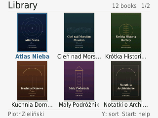
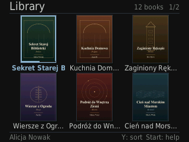

# FroggyReader

**A from-scratch EPUB reader for the Data Frog SF2000 and GB300.**

FroggyReader is a Libretro core for
[`sf2000_multicore`](https://github.com/Trademarked69/sf2000_multicore). It runs
on the 320x240 RGB565 display, uses integer/fixed-point layout only, and
contains no hardware-FPU instructions. The library follows the clean, flat
look of an e-reader rather than a game console: light paper background, a 3x2
cover grid, titles under the covers, and a restrained blue accent.

[Support FroggyReader on Ko-fi](https://ko-fi.com/sajnaps)

| Library | Reading | Night library |
|:---:|:---:|:---:|
|  |  |  |

More captures: [`screenshots/final`](screenshots/final),
[`screenshots/mips`](screenshots/mips), and
[`screenshots/edge`](screenshots/edge). The full test notes are in
[TEST_REPORT.md](TEST_REPORT.md).

## Features

- **EPUB 2 and EPUB 3** — `container.xml`, OPF metadata, spine, NCX, EPUB 3
  navigation documents, nested tables of contents, and `#fragment` links.
- **XHTML + CSS** — tags, classes, IDs, descendant/child selectors,
  `:first-child`, `:last-child`, `:nth-child`, and `!important`.
- **Book formatting** — headings, paragraphs, indentation, justification,
  bold/italic/underline, superscript/subscript, ordered and unordered lists,
  block quotes, tables, `pre`, `hr`, page breaks, backgrounds, and borders.
- **Images** — JPEG, PNG (including alpha), GIF (first frame), and BMP.
  Images are scaled with integer arithmetic and composited onto the page.
- **Kindle-style library** — flat light/night themes, 3x2 grid with 62x82
  covers, titles under each cover, a smooth marquee for a selected long title,
  author and key hints in the footer, title/author sorting, shelf paging,
  progress bars, and bookmark markers.
- **Comfortable reading** — Paper, Sepia, and Night themes; four text sizes;
  three margin widths; optional justification; reflow that keeps the reading
  position; smooth vertical scrolling with the D-pad; independent page turns.
- **Bookmarks and resume** — add, jump to, and delete bookmarks; reading
  position is restored after a reboot.
- **Four UI languages** — English (default), Polish, German, and Japanese.
  The choice is saved in the reader configuration.
- **No FPU** — all layout, scaling, and animation math is integer or
  fixed-point. Final device ELFs are checked for hardware-FPU instructions.

## Controls

### Library

| Button | Action |
|---|---|
| D-pad | Select a book |
| A | Open the selected book |
| Y | Sort by title / author |
| L / R | Previous / next shelf |
| Start | Help |
| Select | Settings (language, theme, text) |
| B | Close help |

### Reader

| Button | Action |
|---|---|
| D-pad Up / Down | Smooth vertical scrolling |
| D-pad Left / Right | Previous / next page |
| A | Book menu |
| B | Back to the library |
| Y | Table of contents |
| X | Add / remove bookmark |
| L / R | Previous / next chapter |
| Start | Settings |
| Select | Cycle theme |

The book menu contains **Contents**, **Bookmarks**, **Settings**, **Info**, and
**Library**. Settings include theme, text size, justification, margins, and UI
language. In the bookmark list, A jumps to a bookmark and X deletes it.

## Requirements

- A Data Frog **SF2000** or **GB300 / GB300V2** running a multicore firmware
  based on
  [`sf2000_multicore`](https://github.com/Trademarked69/sf2000_multicore).
- A FAT32 SD card with about 5 MB free for the core, plus space for books.
- EPUB files without DRM. The reader opens `.epub` files only.

## Installation

### Option A — ready-to-copy SD files (recommended)

1. Open the [latest release](https://github.com/Synaps33/FroggyReader/releases/latest).
2. Download `froggyReader-sd-files.zip`.
3. Extract it. Inside there are `GB300` and `SF2000` folders.
4. Copy the **contents** of the folder for your console to the root of the SD
   card, merging folders when asked.
5. Insert the card and start **ROMS/EPUB.gba** from the menu.
6. Copy your books to `ROMS/epub/books/`.

The SD bundle already installs the core under the name the loader expects,
plus the launcher stub, menu artwork, and display-name configuration.

### Option B — release core only

Download the core for your console:

| Console | Release asset |
|---|---|
| SF2000 | `epub.sf2k` |
| GB300 / GB300V2 | `epub.gb3k` |

Then copy it to the loader's core directory **as `epub.sf2k`** — the
`sf2000_multicore` loader always appends `.sf2k`, including on GB300:

```
/system/Deimos/cores/epub.sf2k
```

Create the launcher stub `ROMS/EPUB.gba` with exactly this text:

```
epub;epub;EPUB.gba
```

Also create these optional copies if your frontend scans several locations:

```
ROMS/epub/EPUB.gba
ROMS/gba/EPUB.gba
```

Finally, copy your books into `ROMS/epub/books/` and start
**ROMS/EPUB.gba** from the menu. Menu artwork and display names are optional;
the complete layout is shown below.

### Option C — install from a source checkout

On Linux, put the two release cores in `dist/` (or build them with
`make device`), then run the installer:

```sh
git clone https://github.com/Synaps33/FroggyReader.git
cd FroggyReader
# copy epub.sf2k and epub.gb3k from the release into dist/
./install_to_sd.sh /media/$USER/GB300
```

The script detects GB300/SF2000, chooses the matching core, and installs the
launcher files and the 12 sample books. To keep your own library untouched:

```sh
./install_to_sd.sh --no-samples /media/$USER/GB300
```

If `dist/epub.sf2k` or `dist/epub.gb3k` is missing, build them first with
`make device` (see [Building](#building)).

### SD card layout

```
/system/Deimos/cores/epub.sf2k       core (required)
/cores/epub/core_87000000            optional secondary copy
/ROMS/EPUB.gba                       launcher stub (required)
/ROMS/epub/EPUB.gba                  optional duplicate stub
/ROMS/gba/EPUB.gba                   optional duplicate stub
/ROMS/epub/books/*.epub              your books
/ROMS/EPUB.rgb565                    menu thumbnail (optional)
/ROMS/epub/EPUB.png                  menu thumbnail (optional)
/ROMS/epub/.res/EPUB.rgb565          menu thumbnail (optional)
/configs/custom_cores/epub/games.opt display names (optional)
/system/saves/epub_reader/reader.cfg created on first run
/ROMS/epub/epub.log                  log (optional)
```

Settings and reading progress are saved to
`/mnt/sda1/system/saves/epub_reader/reader.cfg` on the device. Delete that file
to reset the reader to its defaults.

## Building

### Host runner and tests

Requirements: GCC, GNU Make, Python 3, and Pillow (for PNG conversion and the
sample-library/font generators).

```sh
make            # host test runner: runner/test_runner
make test       # 101 PNG captures in screenshots/final
make edge-test  # empty folder, corrupt EPUB, missing cover: 5 PNGs
```

### MIPS soft-float test under QEMU

Requirements: a `mipsel-linux-muslsf` cross compiler and `qemu-mipsel`.
Override the paths from the Makefile if your toolchain lives elsewhere:

```sh
make test-mips \
  MIPS_MUSL=/path/to/mipsel-linux-muslsf-cross/bin/mipsel-linux-muslsf- \
  QEMU=/path/to/qemu-mipsel \
  SYSROOT=/path/to/mipsel-linux-muslsf
```

This produces 42 PNGs in `screenshots/mips` and runs the same code as the
device build with `-msoft-float -static`.

### Device cores

Requirements: the `mipsel-mti-elf` toolchain and a checkout of
`sf2000_multicore`.

```sh
make device \
  MIPS_ELF=/opt/frog-toolchain/mipsel-mti-elf_stable/bin/mipsel-mti-elf- \
  MULTICORE=/path/to/sf2000_multicore
```

The build creates separate directories for each console so the two builds do
not share stale objects:

```
dist/epub.sf2k                 SF2000 core
dist/epub.gb3k                 GB300 / GB300V2 core
dist/epub_sf2000_core.elf      unstripped SF2000 ELF
dist/epub_gb300_core.elf       unstripped GB300 ELF
```

The final step checks both ELFs for hardware-FPU instructions. The expected
count is **0**.

### Font atlases

The pre-generated 4-bit atlases in `src/fonts_data.c` (book text, DejaVu Serif
Condensed) and `src/fonts_ui_data.c` (UI, DejaVu Sans Condensed) are part of
the repository, so a normal build needs no font libraries on the target.

To regenerate them after changing Japanese UI strings in `src/lang.c`:

```sh
python3 tools/gen_fonts.py
```

The generator uses the system DejaVu fonts and VL Gothic. Edit the paths at the
top of `tools/gen_fonts.py` if they differ on your machine.

## Project layout

| Path | Contents |
|---|---|
| `src/`, `include/` | Reader, EPUB/CSS/XHTML parsers, layout, graphics, UI, languages |
| `third_party/` | `miniz` and `stb_image` |
| `runner/` | Deterministic host/MIPS test runner |
| `tools/` | Font, sample-library, edge-case, and PPM-to-PNG generators |
| `library/` | 12 generated sample EPUBs (Polish text, original fixtures) |
| `library_src/` | Generated cover and illustration sources |
| `screenshots/` | Host, MIPS, and edge-case captures |
| `dist/` | Device builds and launcher artwork |
| `install_to_sd.sh` | SD-card installer for Linux |

## How it works

- **Text:** two embedded 4-bit glyph atlases. Book content uses DejaVu Serif
  Condensed; the interface uses DejaVu Sans Condensed for a clean e-reader
  look. No FreeType or font files are needed at runtime.
- **Layout:** a fixed-point, integer-only pagination engine. Pages are built as
  display lists (text, images, backgrounds, rules) and cached. Smooth
  scrolling composes two page buffers line by line instead of re-rasterizing
  text every frame.
- **Images:** `stb_image` decodes JPEG/PNG/GIF/BMP without HDR or SIMD;
  area sampling and alpha composition are integer operations.
- **EPUB/ZIP:** `miniz` in read-only mode, with archive writing and time APIs
  disabled.
- **No FPU:** built with `-msoft-float`; the reader algorithms use no floating
  point. `make device` verifies the final ELFs.

## Languages

The interface is available in:

- English (default)
- Polski
- Deutsch
- 日本語

The Japanese UI font includes the kana and kanji used by the menus and help
screens. Full Japanese books need a larger CJK font, which is outside this
build. The embedded book font covers Latin, Greek, Cyrillic, and common
typographic punctuation; other scripts show a replacement glyph.

## Limitations

- SVG images and SVG covers are not rasterized; those images are skipped.
- DRM-protected or encrypted EPUBs are not supported.
- No right-to-left layout or complex-script shaping (Arabic, Devanagari, etc.).
- CSS support is a practical subset: no `float`, `position`, `columns`,
  `@font-face`, animations, pseudo-elements, or advanced selectors.
- `font-family` is mapped to the built-in serif face; there is no dictionary
  hyphenation.
- Links inside the text are not clickable; the table of contents handles
  internal anchors.
- No search, delete/rename, or metadata cache. The library is rescanned at
  startup.
- The core has been tested on the host and on MIPS under QEMU, and installed
  to a GB300 SD card. A hands-on session on physical hardware is still
  recommended.

## Testing

The current build passes:

| Test | Result |
|---|---|
| `make test` (host) | exit 0, 101 PNG captures |
| `make test-mips` (QEMU) | exit 0, 42 PNG captures |
| `make edge-test` | exit 0, 5 PNG captures |
| Hardware-FPU instructions | 0 in both final ELFs |
| SF2000 ELF text / data / bss | 4,392,752 / 3,224 / 3,352 bytes |

Details and observations: [TEST_REPORT.md](TEST_REPORT.md).

## Troubleshooting

**The core is not listed in the menu.**
Check that the file is exactly `/system/Deimos/cores/epub.sf2k`, that
`/ROMS/EPUB.gba` contains `epub;epub;EPUB.gba`, and that the card is FAT32.
Reboot the console after copying files.

**A book does not appear in the library.**
Use a DRM-free `.epub` file and put it in `/ROMS/epub/books/`. The folder name
is case-sensitive on some card readers; keep it lower-case.

**The GB300 build does not start.**
The loader looks for `epub.sf2k` on both consoles. Rename the GB300 asset
`epub.gb3k` to `epub.sf2k` when installing it manually, or use the SD bundle.

**The cover is missing.**
SVG-only covers are not supported. The reader shows a generated fallback cover
using the title and author.

**Text looks wrong or the console freezes on start.**
Make sure you installed the build for the correct console. The SF2000 and
GB300 cores are built separately and are not interchangeable.

## Credits

The reader, layout engine, UI, and device integration were written for this
project. It uses:

- [miniz](https://github.com/richgel999/miniz) — MIT / public domain
- [stb_image](https://github.com/nothings/stb) — MIT / public domain
- DejaVu Serif Condensed and DejaVu Sans Condensed — Bitstream Vera License
- VL Gothic (Japanese UI glyphs) — BSD-3-Clause / M+ / Sazanami

See [NOTICE](NOTICE) for the complete third-party notices.

The 12 sample books in `library/` are original test fixtures generated by
`tools/make_test_library.py`; they contain no copyrighted book content.

## Support

If FroggyReader is useful to you, you can support further work on Ko-fi:

[**ko-fi.com/sajnaps**](https://ko-fi.com/sajnaps)
